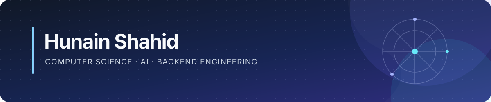

**I build practical software that combines intelligent systems with solid engineering.**

## What I’m interested in

Applied AI and machine learning · RAG and information retrieval · Backend systems · Data structures and algorithms

## Languages & Query Languages

## Skills

### Frontend Development

### Backend & APIs

### Databases, Data & Machine Learning

### Knowledge Graphs & Logic

### Developer Tools, Platforms & Infrastructure

---

*Building useful things, learning by shipping.*

